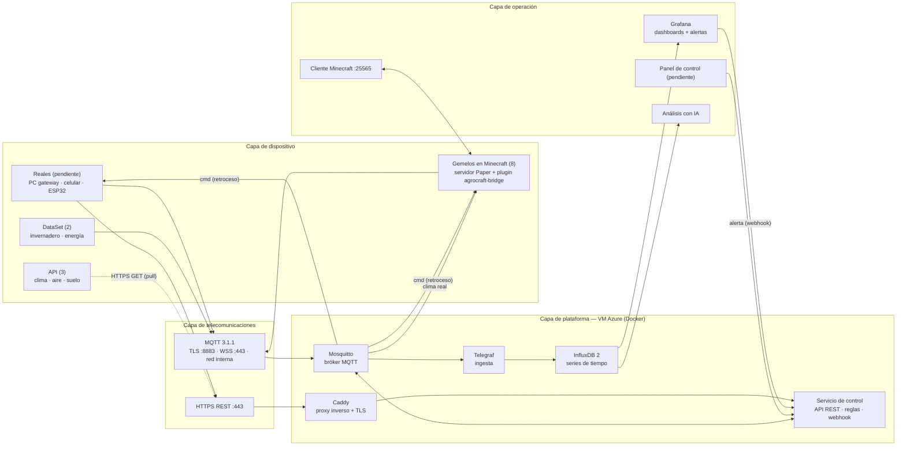

# Proyecto Final IoT — AgroCraft: granja inteligente con gemelo digital en Minecraft

Universidad Autónoma de Bucaramanga · IoT + Cloud + Sistemas Distribuidos
Versión 4 · actualizado miércoles 2026-11-11, 09:00 (hora Colombia)

> **Idea central.** Un mundo de Minecraft alojado en la nube es el gemelo digital 3D de una granja
> inteligente. Los bloques del juego son sensores y actuadores: publican telemetría por MQTT como
> cualquier dispositivo IoT y obedecen comandos de la plataforma. El clima real de Bucaramanga entra
> al juego.

---

## 1. Estado y cómo retomar

**La captura de datos ya está corriendo.** No apagar la VM ni cambiar nombres de variables.

| Qué | Estado |
|---|---|
| Plataforma en la VM (Caddy, Mosquitto, Telegraf, InfluxDB, Grafana) | Funcionando |
| Grafana: https://agrocraft.northcentralus.cloudapp.azure.com | 5 dashboards como código, verificados con datos |
| Alertas de Grafana (6 reglas, una alerta por dispositivo) | Funcionando; contacto webhook → servicio de control, probado |
| Servicio de control `/iot/`: panel, API REST, reglas en la nube, ingesta HTTPS | Funcionando y probado de punta a punta |
| MQTT sobre TLS (`:8883`) y sobre WebSocket (`/mqtt`) | Verificados desde fuera |
| Dispositivos de API (3) y de dataset (2) | **Capturando desde 11 nov 00:50** |
| Servidor Minecraft (Paper 1.21.11) + plugin `agrocraft-bridge` 0.1.0 | Funcionando, granja construida |
| Gemelos de Minecraft (8) | **Capturando desde 11 nov 01:05** |
| Real `gw-pc-01` (agente del PC, MQTT/TLS) | **Capturando desde 11 nov 08:24** · solo mientras el PC esté encendido |
| Real `phone-01` (celular → HTTPS) | Endpoint listo y probado; falta configurar la app en un celular |
| Real `esp32-01` | Pendiente (D4: ¿hay hardware?) |
| Copias de seguridad | Diarias 03:30 en la VM (systemd); primera copia ya descargada al PC |
| Repositorio | https://github.com/MarcozVD/agrocraft-iot (privado) |
| Mapa web, plugin 0.2, documento | Pendientes |

Total: **14 dispositivos con datos** (8 gemelos + 3 API + 2 dataset + 1 real). Las cuatro clases
cubiertas.

### Siguientes pasos, en orden

1. ~~**Arranque automático del agente `gw-pc-01`**~~ **Hecho (11 nov):** acceso directo en la carpeta Inicio de Windows. Comando usado:
   `powershell -ExecutionPolicy Bypass -File devices
eal\pc-agent\install-autostart.ps1`
   (lo debe ejecutar el usuario; crea un acceso directo en la carpeta Inicio). Sin esto, el agente
   se detiene al reiniciar el PC.
2. **`phone-01`**: instalar Sensor Logger en un celular y configurar HTTP Push (ver `README.md`).
3. **Canal de notificación humano** para las alertas (Telegram o Discord): agregar un segundo
   receptor en `platform/grafana/provisioning/alerting/contact-points.yml` (requiere token del bot).
4. **Mapa web** y acceso al mundo: decidir D8, lista blanca con los nombres de jugador, plugin de
   inicio de sesión.
5. **`esp32-01`** si hay hardware (adaptar sketch del Lab 2 al bróker propio, puerto 8883).
6. **Plugin 0.2**: pantallas con lecturas reales dentro del juego, palanca que enciende el LED del
   ESP32, eventos de jugadores.
7. **Experimentos de retroceso** con hora y motivo anotados (sección 9, Fase 5). Se pueden hacer
   desde el panel `/iot/`; quedan marcados en las gráficas.
8. **Documento**, análisis con IA, PDF, repositorio público, sustentación. Capturas de los
   dashboards ya en `docs/evidencias/` (regenerarlas al cierre con más días de datos).

Operación diaria (entrar a la VM, ver registros, enviar comandos, desplegar): ver `README.md`.

---

## 2. Decisiones

| # | Decisión | Estado |
|---|---|---|
| D1 | Cuenta de Minecraft | **Decidido:** clientes con TLauncher, sin cuenta oficial → `online-mode=false` con las protecciones de la sección 7 |
| D2 | Tamaño de VM | **Hecho:** `Standard_B2als_v2` (4 GiB), US$0.0376/h ≈ US$0.90/día. Uso medido: 2.4 GB. Volver a `B2ats_v2` tras la sustentación |
| D3 | Versión del servidor | **Hecho:** Paper 1.21.11 (los clientes deben usar 1.21.11) |
| D4 | Hardware real | **Abierta:** ¿hay ESP32 físico con sensores? Sin él, los reales son PC y celular |
| D5 | URL | **Hecho:** `agrocraft.northcentralus.cloudapp.azure.com` |
| D6 | Repositorio | **Hecho:** cuenta `MarcozVD`, repo `agrocraft-iot`, privado por ahora; hacerlo público para la entrega |
| D7 | Entrega | **Lunes 16 o jueves 19 de noviembre** (confirmar con el docente). El cronograma cubre ambos casos |
| D8 | Mapa web | **Abierta.** BlueMap está instalado pero inactivo: para activarlo hay que declarar en su configuración que se tiene licencia de Minecraft Java, y el grupo no la tiene. Alternativas sin esa condición: squaremap (2D) o Dynmap (vista isométrica) |
| D9 | Quién entra al mundo | **Abierta:** nombres de jugador para la lista blanca e IP públicas de los integrantes para el puerto 25565 (hoy solo la IP de un integrante) |

---

## 3. Escenario — AgroCraft

**Contexto.** Una granja en Santander quiere operar con datos: saber cuándo regar, cuándo ventilar,
cuánta agua queda y si hay intrusos, sin recorrer el terreno. Antes de invertir en sensores para toda
la finca, construye un **gemelo digital** donde probar reglas de riego, alertas y automatismos. Ese
gemelo es un mundo de Minecraft: cada parcela, tanque, silo e invernadero existe como estructura del
juego y se comporta según un modelo alimentado por el clima real.

**Preguntas de negocio.**
1. ¿Cuál es el estado de cada parcela, del tanque y del invernadero ahora y en los últimos días?
2. ¿Cuándo regar o ventilar, y puede hacerse de forma remota o automática?
3. ¿Cómo afecta el clima real (lluvia, radiación, evapotranspiración) al comportamiento de la granja?
4. ¿Qué dispositivos están fuera de línea, descalibrados o reportando valores anómalos?

**Acoplamientos entre el mundo real y el gemelo.**
- Mundo real → juego (funciona): la hora del mundo sigue la hora de Colombia; llueve en el juego
  cuando la API reporta lluvia; la evapotranspiración real seca las parcelas; la temperatura y la
  radiación reales calientan el invernadero; la lluvia recarga el tanque.
- Juego → plataforma (funciona): telemetría y eventos (riego, cosecha, bomba, intruso, alarma).
- Plataforma → juego (funciona por línea de comandos; falta panel): riego, lámparas, ventilas,
  calefacción, bomba, alarma, portón, clima y hora, además de apagar, recalibrar o cambiar el
  intervalo de cualquier gemelo.
- Juego → mundo físico (pendiente): palanca del juego que enciende el LED del ESP32.

---

## 4. Arquitectura de referencia propia

Cuatro capas vistas en clase, con plataforma a la medida en lugar de IoT Central.



**Envío (telemetría):** dispositivo → MQTT (QoS 1) → Mosquitto → Telegraf → InfluxDB → Grafana.
**Recepción (retroceso):** operador o regla → MQTT `cmd` → dispositivo → aplica el cambio → `ack` y
`state` retenido → quedan en InfluxDB (medición `events`) para anotar las gráficas.

**Seguridad:** certificado Let's Encrypt (Caddy, compartido con Mosquitto), bróker sin acceso anónimo,
un usuario por dispositivo con ACL que solo le deja sus propios temas, secretos solo en la VM
(`platform/.env`), SSH solo por llave.

---

## 5. Dispositivos (16 planeados: 13 con datos, 3 pendientes)

### 5.1 Gemelos digitales en Minecraft — funcionando

| ID | Qué es en el juego | Variables | Sensor real que representa | Retroceso propio |
|---|---|---|---|---|
| `mc-parcela-a` | Parcela de trigo | `soil_pct` 0…100 · `growth_pct` 0…100 · `mature_count` 0…72 · `light_lvl` 0…15 · `irrigation` · `lamp` · `harvests` | Sonda capacitiva de humedad · BH1750 | Riego, lámpara; `auto`, `soil_min` (35), `soil_max` (65) |
| `mc-parcela-b` | Parcela de zanahoria y papa (se seca 25 % más rápido, crece 15 % más lento) | igual | igual | igual |
| `mc-tanque` | Tanque de 2000 L con nivel visible | `level_pct` · `volume_l` · `outflow_lpm` · `inflow_lpm` · `pump` | Ultrasónico JSN-SR04T · caudalímetro YF-S201 | Bomba; `auto`, `level_min` (25), `level_max` (90) |
| `mc-invernadero` | Invernadero de vidrio | `temp_c` · `hum_pct` · `light_lvl` · `vent_open` · `heater` · `lamp` | SHT31 · BH1750 | Ventilas, calefacción, lámparas; `auto` y cuatro umbrales |
| `mc-silo` | Barril de cosecha | `fill_pct` · `items` · `comparator_lvl` 0…15 · `received_total` · `dispatched_total` | Celda de carga | Descarga; `auto`, `dispatch_at` (80) |
| `mc-seguridad` | Perímetro cercado | `hostiles_near` · `players_in_zone` · `gate_open` · `alarm` · `intruders_total` | PIR · contacto de puerta | Alarma, portón; `auto`, `simulate` |
| `mc-estacion` | Estación meteorológica del mundo | `raining` · `thundering` · `daylight_lvl` 0…15 · `time_ticks` | Pluviómetro · piranómetro | `set_weather`, `set_time`; `sync_weather`, `sync_time` |
| `mc-server` | Salud del gemelo | `tps` · `mspt` · `players_online` · `heap_mb` · `loaded_chunks` · `entities` | Monitoreo de gateway | — |

Intervalo: 30 s (silo y estación: 60 s). Todos por MQTT desde el plugin (usuario `mc-bridge`).

**Modelo** (lo calcula el plugin; el mundo evoluciona sin jugadores conectados):
- Suelo: baja `0.5 + 12 × ET0 real (mm/h)` puntos por hora; el riego lo sube 120 puntos por hora
  tomando 20 L/min del tanque; la lluvia real lo sube 8 puntos por mm.
- Cultivo: ciclo ideal de 20 horas, frenado por suelo seco, poca luz o temperatura fuera de rango.
  Al llegar a 100 % se cosecha (288 unidades al silo) y se resiembra.
- Tanque: la bomba aporta 30 L/min; la lluvia real, 40 L por mm.
- Invernadero: la temperatura persigue a la exterior real más `0.012 × radiación (W/m²)`; las
  ventilas abiertas reducen esa ganancia al 35 %.
- Control local con histéresis en parcelas, tanque, invernadero, silo y alarma. Un comando manual
  sobre un actuador lo saca de automático; `set_config {"auto":1}` lo devuelve.
- Seguridad: de noche aparece de vez en cuando un intruso (zombi) que se retira a los pocos minutos.

### 5.2 API — funcionando

| ID | Fuente | Variables | Intervalo |
|---|---|---|---|
| `api-clima` | Open-Meteo Forecast | `temp_c`, `hum_pct`, `precip_mm`, `rain_mm`, `wind_kmh`, `radiation_wm2`, `pressure_hpa`, `cloud_pct`, `is_day`, `weather_code` | 5 min |
| `api-aire` | Open-Meteo Air Quality | `pm2_5`, `pm10`, `o3`, `no2`, `uv_index`, `us_aqi` | 10 min |
| `api-suelo` | Open-Meteo Forecast (suelo) | `soil_temp_c`, `soil_moist_m3m3`, `et0_mm`, `et_mm`, `vpd_kpa` | 10 min |

Consulta HTTPS GET y publicación por MQTT. Retroceso propio: `set_location`. Open-Meteo actualiza
cada 15 min (aire: cada hora), así que la lectura se repite entre actualizaciones.

### 5.3 DataSet — funcionando

| ID | Fuente | Variables | Paso |
|---|---|---|---|
| `ds-invernadero` | Autonomous Greenhouse Challenge 2019, equipo Reference (Wageningen, vía CEAOD) | `temp_c`, `hum_pct`, `co2_ppm`, `par_umol`, `vent_pct`, `pipe_temp_c`, `irrigation_lm2` | 5 min |
| `ds-energia` | UCI Individual Household Electric Power Consumption | `power_kw`, `reactive_kvar`, `voltage_v`, `current_a` | 1 min |

Reproducción con desplazamiento fijo de fecha: el 11 nov 2026 corresponde al 1 abr 2020 (invernadero)
y al 11 nov 2009 (energía, mismo día de la semana). Retroceso propio: `set_speed`, `restart`.

### 5.4 Reales — pendientes

| ID | Dispositivo | Variables | Protocolo |
|---|---|---|---|
| `gw-pc-01` | PC como gateway de campo (agente Python `psutil`) | `cpu_pct`, `ram_pct`, `cpu_temp_c`, `battery_pct`, `wifi_rssi_dbm` | MQTT 3.1.1 / TLS 8883 |
| `phone-01` | Celular (app Sensor Logger) | `lux`, `pressure_hpa`, `battery_pct` | HTTPS POST → servicio de control → MQTT |
| `esp32-01` | ESP32 + DHT22 + LDR + LED *(si hay hardware)* | `temp_c`, `hum_pct`, `lux`, `led` | MQTT 3.1.1 / TLS 8883 |

Los tres usuarios ya existen en el bróker. Para la tabla del documento faltan los rangos de datasheet
de cada sensor de referencia (formato del Taller Teórico 1).

---

## 6. Contrato de datos (congelado: la captura ya lo usa)

**Temas MQTT** — `agro/<clase>/<device_id>/<canal>`, con `clase` ∈ `real | twin | api | dataset`.

| Canal | Sentido | QoS / retenido | Contenido |
|---|---|---|---|
| `telemetry` | dispositivo → nube | QoS 1 | `{"ts": <unix ms>, "seq": n, "<variable>": número, ...}` |
| `status` | dispositivo → nube | retenido + última voluntad | `online` / `offline` |
| `state` | dispositivo → nube | retenido | `enabled`, `interval_s`, `calibration`, actuadores y configuración |
| `event` | dispositivo → nube | QoS 1 | `{"ts": ..., "type": "...", ...}` |
| `cmd` | nube → dispositivo | QoS 1 | `{"cmd_id": "...", "action": "...", "params": {...}}` |
| `ack` | dispositivo → nube | QoS 1 | `{"ts": ..., "cmd_id": "...", "action": "...", "ok": true, "detail": "..."}` |

**Reglas del contrato.**
- En `telemetry` solo van números (los estados encendido/apagado son 1/0). Así InfluxDB nunca
  rechaza un punto por conflicto de tipo.
- Se pueden agregar variables nuevas; no se renombran ni se quitan las existentes.

**Comandos.**

| Acción | Parámetros | Aplica a |
|---|---|---|
| `set_enabled` | `{"enabled": 0\|1}` | Todos |
| `set_interval` | `{"interval_s": 5…3600}` | Todos |
| `calibrate` | `{"variable": "...", "offset": n, "gain": n}` o `{"reset": true}` | Todos |
| `reboot` | — | Todos |
| `set_actuator` | `{"name": "...", "value": 0\|1}` | Gemelos |
| `set_config` | claves de configuración del gemelo | Gemelos |
| `set_weather` / `set_time` | `{"weather": "clear\|rain\|thunder"}` / `{"ticks": 0…23999}` | `mc-estacion` |
| `set_location` | `{"latitude": n, "longitude": n}` | API |
| `set_speed` / `restart` | `{"speed": 0…120}` / — | DataSet |

**Almacenamiento.** InfluxDB 2, organización `agrocraft`, bucket `telemetry`, sin caducidad.
Medición `telemetry` (etiquetas `class`, `device`; un campo por variable) y medición `events`
(etiquetas `class`, `device`, `channel`; campo `value` con el mensaje tal cual). Tiempo en UTC.

---

## 7. Plataforma

| Servicio | Función | RAM medida |
|---|---|---|
| Paper 1.21.11 + `agrocraft-bridge` | Servidor de Minecraft y gemelos (heap 1.5 GB) | 1590 MB |
| Grafana 12.1 | Dashboards, alertas (lectura anónima activada) | 121 MB |
| InfluxDB 2.7 | Series de tiempo | 77 MB |
| `fleet` (Python) | 3 API + 2 dataset, un cliente MQTT por dispositivo | 65 MB |
| Telegraf 1.35 | Suscriptor MQTT → InfluxDB | 28 MB |
| Caddy 2 | Proxy inverso, HTTPS automático | 21 MB |
| Mosquitto 2.0 | Bróker: 1883 interno, 8883 TLS, 9001 WebSocket | 6 MB |

VM: 2.4 GB usados de 3.9 GB, más 2 GB de swap. Todos los servicios reinician solos.

**Servidor sin verificación de cuentas (`online-mode=false`).** Quien alcance el puerto 25565 puede
entrar con cualquier nombre. Protecciones:
1. Puerto 25565 abierto solo a IP conocidas — **hecho** (hoy una sola IP).
2. Lista blanca obligatoria — **hecho**, vacía: nadie entra hasta agregar nombres.
3. Sin operadores dentro del juego; RCON solo en la red interna — **hecho**.
4. Plugin de inicio de sesión con contraseña — pendiente (verificar compatibilidad con 1.21.11).
5. Copia diaria del mundo — pendiente.

**Accesos** (`<host>` = `agrocraft.northcentralus.cloudapp.azure.com`).

| URL | Destino | Estado |
|---|---|---|
| `https://<host>/` | Grafana | Funciona |
| `wss://<host>/mqtt` | MQTT sobre WebSocket | Funciona |
| `mqtts://<host>:8883` | MQTT sobre TLS | Funciona |
| `<host>:25565` | Servidor de Minecraft | Funciona (IP y lista blanca restringidas) |
| `https://<host>/map` | Mapa web del mundo | Pendiente (D8) |
| `https://<host>/iot/` | Panel de control y API REST (servicio `control`) | Funciona |

**Firewall `iot-nsg`:** 22, 80, 443 y 8883 abiertos; 25565 solo desde la IP de un integrante.

---

## 8. Visualización y procesamiento (pendiente)

**Dashboards Grafana** (variables: dispositivo, clase, ventana de agregación; selector de tiempo libre).
1. **Resumen**: estado de los dispositivos, últimas lecturas, alertas activas.
2. **Cultivo y riego**: parcelas, tanque, evapotranspiración y lluvia reales, ciclos de cosecha.
3. **Invernadero**: gemelo frente a clima exterior real y frente al invernadero del dataset.
4. **Seguridad y operación**: intrusos, eventos, comandos y acks.
5. **Por dispositivo**: todas sus variables con promedio, máximo y mínimo del rango elegido.
6. **Salud**: TPS del servidor, dispositivos fuera de línea, huecos de datos (campo `seq`).

**Procesamiento.** Promedio, máximo y mínimo por ventana (`aggregateWindow` atado al selector de
tiempo); tarea de InfluxDB con resumen horario; derivadas: déficit de presión de vapor, agua
consumida por día, cosechas por día. Anotaciones desde la medición `events`.

**Alertas (Grafana Alerting).**

| Alerta | Condición | Acción |
|---|---|---|
| Suelo seco | `soil_pct` < 30 % por 10 min | Notificación + webhook |
| Estrés térmico | `temp_c` del invernadero > 32 °C por 5 min | Notificación + webhook |
| Tanque bajo | `level_pct` < 20 % | Notificación |
| Intruso | `hostiles_near` > 0 | Notificación |
| Dispositivo fuera de línea | Sin datos por 3 intervalos | Notificación |
| Gemelo degradado | `tps` < 15 por 5 min | Notificación |

**Reglas en la nube (servicio de control, `platform/control/rules.py`).** Implementadas: `lamparas-radiacion` y `aire-ventilas`. Los gemelos ya traen control local; las reglas en la nube sirven
para mostrar retroceso iniciado por la plataforma: por ejemplo, cortar el riego si el tanque baja de
15 %, o encender lámparas de crecimiento cuando la radiación real es baja durante el día.

---

## 9. Cronograma

Captura iniciada el miércoles 11 a la 01:05. Cuatro días completos se cumplen el domingo 15 a la
01:05; seis, el martes 17 a la 01:05.

### Hecho (martes 10 y miércoles 11)
- [x] Fase 0: VM redimensionada y encendida, URL, firewall, repositorio.
- [x] Fase 1: plataforma con HTTPS y MQTT/TLS; contrato de datos; flota de API y dataset.
- [x] Fase 2 y parte de la 3: servidor Paper, plugin con los 8 gemelos, granja generada por el
  plugin, comandos de retroceso, clima y hora reales dentro del juego.

### Fase 3 — Reales y operación · miércoles 11 y jueves 12
- [x] `gw-pc-01` publicando (11 nov 08:24). - [x] Arranque automático con Windows.
- [x] Copia de seguridad diaria (systemd, 03:30).
- [x] Servicio de control con usuario operador: ingesta HTTP, comandos por REST, panel `/iot/` (reemplaza a Node-RED).
- [ ] `phone-01`; `esp32-01` si hay hardware.
- [ ] Revisar saldo de crédito en el portal de Azure for Students.

### Fase 4 — Visualización, alertas y reglas · jueves 12 y viernes 13
- [x] 5 dashboards como código (Resumen, Cultivo, Clima, Operación, Por dispositivo).
- [x] Alertas (6) + webhook al servicio de control; reglas en la nube. - [ ] Canal humano (Telegram/Discord).
- [ ] Mapa web (D8), lista blanca e inicio de sesión.

### Fase 5 — Experimentos de retroceso · viernes 13 a domingo 15
Ejecutar a propósito, anotando hora y motivo (quedan visibles en gráficas y en el mundo):
- [ ] Apagar un sensor 1 hora y volver a encenderlo (`set_enabled`).
- [ ] Recalibrar un sensor y luego corregirlo (`calibrate`).
- [ ] Cambiar el intervalo de muestreo y regresar (`set_interval`).
- [ ] Sacar el riego de automático hasta disparar la alerta de suelo seco; reactivarlo.
- [ ] Forzar tormenta (`set_weather`) y observar tanque y suelo; volver a sincronizar.
- [ ] Encender la alarma y abrir el portón por comando.
- [ ] Cambiar umbrales (`set_config`) y observar el nuevo ciclo de riego.
- [ ] Grabar un video corto de demostración.

### Fase 6 — Documento y entrega
| Si la entrega es | Ventana de datos en el documento | Documento listo |
|---|---|---|
| Lunes 16 | 11 al 15 de noviembre (4 días y medio) | Domingo 15 en la noche |
| Jueves 19 | 11 al 17 de noviembre (6 días) | Miércoles 18 |

- [ ] Exportar gráficas y estadísticas por dispositivo.
- [ ] Análisis de comportamiento con IA, revisado contra cada gráfica.
- [ ] Documento en PDF (sección 10); repositorio público; ensayo de sustentación individual.
- [ ] Mantener la VM encendida hasta después de la sustentación; luego volver a `B2ats_v2`.

**Si el tiempo aprieta, recortar en este orden:** plugin 0.2 → mapa web → `phone-01` → `esp32-01`
(los comandos siguen funcionando por `scripts/cmd.sh`). No recortar: `gw-pc-01`, dashboards,
alertas, experimentos de retroceso, documento.

### Extras opcionales
- AMQP con RabbitMQ para `ds-energia` (reutiliza `python-qpid-proton` del Lab 4); cubre los tres
  protocolos vistos en clase. Requiere medir memoria antes.
- Agrónomo con IA: agente que lee la telemetría, decide riego y ventilación y envía los comandos.
- Compilación automática del plugin con GitHub Actions.

---

## 10. Documento final y trazabilidad con el enunciado

| Sección del documento | Contenido | Requisito que cubre | Evidencia |
|---|---|---|---|
| 1. Descripción y contexto | AgroCraft, problema, preguntas de negocio, por qué un gemelo en Minecraft | Escenario libre | Sección 3 + capturas del mundo |
| 2. Arquitectura de referencia | Diagrama por capas, flujos de envío y recepción, servicios | Arquitectura propia; protocolos y servicios dentro de ella | Sección 4 → `docs/arquitectura/` |
| 3.1 Sensores y dispositivos | Tabla de dispositivos, variables y rangos, por clase | 10+ dispositivos en Real / Twin / API / DataSet con su protocolo | Sección 5 + dashboard Resumen |
| 3.2 Comunicación | Mosquitto, MQTT/TLS, HTTPS, temas, QoS, última voluntad, retenidos | Envío y recepción con protocolos vistos en clase | Sección 6 + captura de tráfico |
| 3.3 Nube y servicios | VM Azure, Docker, cada servicio y su papel | Nube, URL propia, infraestructura propia | URL pública + `docker compose ps` |
| 3.4 Visualización y procesamiento | Dashboards, promedio/máx/mín, alertas, reglas, ajuste de tiempo | Visualización y procesamiento | Capturas a distintos rangos |
| 3.5 Retroceso | Comandos y experimentos de la Fase 5, antes y después | Sensor modificable, apagable, ajustable, calibrable | Gráfica con anotación + captura del mundo |
| 3.6 Análisis con IA | Comportamiento de cada dispositivo durante la captura | Análisis de gráficas con IA | `analysis/` + gráficas de 4 a 6 días |
| 4. Referencias | Datasheets, Open-Meteo, datasets, Paper, Mosquitto, Telegraf, InfluxDB, Grafana, Caddy | Referencias | — |

Entrega: PDF + repositorio GitHub + URL en vivo + sustentación individual. Cada integrante debe poder
explicar cualquier capa y ejecutar un comando de retroceso en vivo.

---

## 11. Riesgos

| Riesgo | Mitigación |
|---|---|
| La clase "Real" llega tarde y queda con pocos días de datos | `gw-pc-01` es el siguiente paso; el PC debe quedar encendido |
| VM apagada o crédito agotado a mitad de captura | Revisar saldo; alerta "sin datos"; no hay auto-apagado programado |
| Pérdida de datos (aún no hay copias) | Copia diaria fuera de la VM: paso 3 |
| Reiniciar Minecraft para actualizar el plugin deja huecos de unos 40 s | Actualizar pocas veces; el estado del modelo se guarda cada minuto y se restaura |
| Cambios al contrato con la captura en curso | Solo agregar variables; nunca renombrar |
| Servidor sin verificación de cuentas | Sección 7: IP restringida, lista blanca, sin operadores |
| Cliente no oficial: incumple el EULA de Minecraft y puede cuestionarse en la sustentación | El docente no necesita el juego para evaluar (Grafana y, si se resuelve D8, mapa web); alternativas: una licencia oficial para la demostración o migrar a Luanti |
| La IP de casa cambia y deja de entrar al puerto 25565 | Actualizar la regla `Minecraft` del firewall (sección 12) |
| Modelo con dinámica poco vistosa (riega muy seguido o casi nunca) | Ajustar umbrales por `set_config` sin reiniciar; constantes en `PlotTwin.java` y `TankTwin.java` |
| "Es solo un juego" en la sustentación | Presentarlo como gemelo digital: modelo anclado a sensores reales, acoplado a clima real, con ciclo completo de telemetría y comando |

---

## 12. Comandos Azure de referencia

```bash
# Encender / apagar sin borrar (la IP y la URL se conservan)
az vm start      -g SOURCE -n iot
az vm deallocate -g SOURCE -n iot

# Agregar o cambiar las IP que pueden entrar al servidor de Minecraft
az network nsg rule update -g SOURCE --nsg-name iot-nsg -n Minecraft \
  --source-address-prefixes <ip_1>/32 <ip_2>/32

# Opcional: restringir SSH a la IP propia (hoy solo acepta llave, sin contraseña)
az network nsg rule update -g SOURCE --nsg-name iot-nsg -n SSH \
  --source-address-prefixes <mi_ip>/32

# Al terminar el proyecto: volver al tamaño gratuito
az vm resize -g SOURCE -n iot --size Standard_B2ats_v2
```

Hecho el 11 nov: `az vm resize ... Standard_B2als_v2`, `az vm start`, etiqueta DNS `agrocraft`,
reglas `MQTTS` (8883, prioridad 360) y `Minecraft` (25565, prioridad 380).
